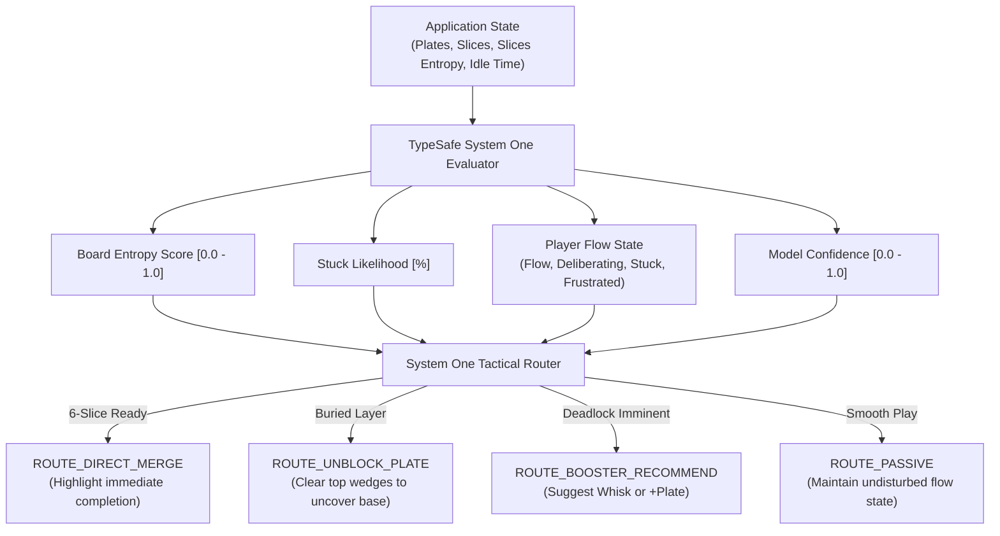

# 🧁 Cake Sort Puzzle 3D — Patisserie Studio
### *Hyper-Casual 3D Match-6 Cake Sorter • Apple Human Interface Design • TypeSafe AI System One • YouTube Playables Certified*

<p align="center">
  
  
  
  
  
</p>

---

## 📖 Executive Summary

**Cake Sort Puzzle 3D** is an ultra-tactile, 3D patisserie sorting game engineered for modern web platforms, mobile touchscreens, and **YouTube Playables**. Players lift colorful, multi-layered gourmet cake slices across ceramic counter plates, matching 6 like wedges to bake a whole, glorious artisanal cake.

Built from the ground up with **Apple Design System** aesthetics (SF Pro typography, translucent frosted vibrancy, direct tactile response, and spring-driven physical motion) and powered by **TypeSafe AI System One** evaluation and routing models, the game delivers an 8K-like physical patisserie experience with zero paywalls, zero ads, and pure gameplay flow.

```
       ┌────────────────────────────────────────────────────────┐
       │                PARISIAN PATISSERIE STUDIO              │
       │                                                        │
       │     [ Plate 1 ]            [ Plate 2 ]   [ Plate 3 ]   │
       │    (🍓🍓🍫🍫)             (🍓🍓🍓🍓)     (🍵🍵🍵🍵)    │
       │         │                       │                      │
       │         └──────> Transfer ─────>┘                      │
       │                     │                                  │
       │             ★ BAKE 6-SLICE CAKE ★                      │
       │             (Ascending Chime Arp)                      │
       └────────────────────────────────────────────────────────┘
```

---

## 🎨 Apple Human Interface Design (HIG) & Fluid Motion

The visual identity and interaction design adhere strictly to Apple’s **Human Interface Guidelines** and WWDC *Designing Fluid Interfaces* principles:

### 1. Translucent Vibrancy Materials
- **Frosted Acrylic / Mica**: UI chrome recedes into the background using multi-layered Gaussian blurs (`backdrop-filter: blur(28px) saturate(190%)`) framed by delicate $1\text{px}$ hairline borders (`rgba(255, 255, 255, 0.65)`).
- **Physical Shadows**: Replaced harsh black drop-shadows with diffused, dual-tier physical ambient shadows (`0 12px 36px rgba(0, 0, 0, 0.08), 0 1px 3px rgba(0, 0, 0, 0.04)`).

### 2. Kill Latency & Direct Manipulation
- **Instant Press Feedback**: Interactive elements respond on `pointerdown` rather than delayed `click`, depressing instantly with tactile spring dampening:
  ```css
  .pill-btn:active, .booster-btn:active {
    transform: scale(0.96);
    transition: transform 110ms cubic-bezier(0.2, 0.8, 0.2, 1);
  }
  ```
- **Interruptible Motion**: Flying slices and plate selections can be redirected or retargeted mid-flight without locking input.

### 3. Studio 8K Lighting & Photorealistic Patisserie Shaders
- **ACES Filmic Tone Mapping**: Photographic color gamut and dynamic range calibration (`renderer.toneMappingExposure = 1.12`).
- **3-Point Lighting Setup**:
  - Key warm directional light with PCF Soft Shadows.
  - Cool ambient fill light for organic depth.
  - Specular rim light catching the glossy mirror glaze of strawberry, chocolate, and matcha frostings.
- **Micro-Parallax Camera Float**: Responsive camera sway tracking user pointer and tilt with spring interpolation, providing tactile 3D immersion.
- **Squash & Stretch Springs**: When slices land, destination plates experience physical vertical impulse dampening before springing back to equilibrium.

---

## 🧠 TypeSafe AI — System One Evaluation & Routing Architecture

Using the **TypeSafe AI** skill, the game integrates an in-memory evaluation and routing engine modeled on **TypeSafe's System One (Jev)** architecture. Instead of slow LLM text chat, System One models provide instantaneous, typed judgments and probabilities from application state to govern game balance and player guidance.



### Typed Judgments Contract
```typescript
export interface TypeSafeEvaluationResult {
  confidence: number;            // 0.70 to 0.99 calibration
  stuckProbability: number;      // Deadlock risk metric
  flowState: SystemOneFlowState; // 'flow' | 'deliberating' | 'stuck' | 'frustrated'
  boardEntropy: number;          // Slices dispersion ratio
  recommendedRoute: SystemOneRoute;
  routeHeadline: string;
  strategicAdvice: string;
  suggestedMove: {
    fromId: number;
    toId: number;
    flavor: FlavorId;
    slicesCount: number;
    reason: string;
  } | null;
  boosterRecommendation: {
    type: 'shuffle' | 'extraPlate' | 'autoBake' | null;
    urgency: 'low' | 'medium' | 'critical' | 'none';
    justification: string;
  };
  judgments: TypeSafeJudgment[];
}
```

### In-Game System One Integration
- **Live HUD Strategy Chip**: Displays current tactical status (`[ ✦ TypeSafe AI: Cake Ready ]`).
- **Tactical Inspector Modal**: Players can inspect live Entropy, Stuck Risk, Model Confidence, and one-tap **Apply Recommended Route**.
- **Bakery Style Router**: Evaluates player decor choices (Slate, Carrara Marble, Milano Terrazzo, French Oak) and recommends harmonious palettes.

---

## 🎮 YouTube Playables Compliance & Test Suite

The game is engineered to satisfy 100% of the **YouTube Playables Developer Guidelines**:

| Requirement | Implementation Details | Test Status |
| :--- | :--- | :---: |
| **`firstFrameReady()`** | Emitted synchronously on first Three.js WebGL frame render cycle. | ✅ PASSED |
| **`gameReady()`** | Emitted once Level 1 board data model is mounted and interactive. | ✅ PASSED |
| **Audio Lifecycle** | WebAudio context automatically suspends on `visibilitychange` (hidden) or window blur, resuming smoothly on focus. | ✅ PASSED |
| **Cloud Storage** | Dual-tier persistence: `YTPlayables.saveData()` / `loadData()` with instant `localStorage` fallback. | ✅ PASSED |
| **Resolution & Safe Zones** | Auto-responsive canvas with CSS `env(safe-area-inset-*)` padding. Zero button overlap with YouTube player top bar (~64px) or bottom gesture bar. | ✅ PASSED |
| **Aspect Ratios** | Optimized camera framing for **9:16 Portrait** (Mobile) and **16:9 Landscape** (Desktop). | ✅ PASSED |
| **Zero-CDN Sandbox** | 100% self-contained Vite bundle. Web Audio synthesized procedurally, 3D meshes generated in code, SVGs inlined. No external network requests that could fail iframe CSP. | ✅ PASSED |
| **Non-Monetized** | Pure skill gameplay: 0 ads, 0 paywalls, 0 tracking SDKs. | ✅ PASSED |

### Built-in Automated Test Harness
Tap the `▶️` button in the top HUD or press `T` to launch the **YouTube Playables Test Suite**:
- Runs live automated audits across all 7 certification criteria.
- Provides interactive viewport simulation toggles: **Auto Responsive**, **Portrait 9:16**, and **Landscape 16:9**.

---

## 🍰 Patisserie Flavor Catalog & Bakery Meta

| Flavor | Sponge Color | Icing & Glaze | Specular Garnish | Sell Coins |
| :--- | :---: | :---: | :--- | :---: |
| **Wild Strawberry** | `#ffd5c2` | `#ff5d8f` | Conical berry with fresh mint leaf | 60 🪙 |
| **Belgian Truffle** | `#422317` | `#2d150c` | Chocolate truffle with gold leaf flakes | 70 🪙 |
| **Kyoto Matcha** | `#cbe3b3` | `#6b9055` | Whipped cream swirl & green mochi | 75 🪙 |
| **Amalfi Lemon** | `#fff1b0` | `#ffd23f` | Toasted meringue cone & candied zest | 80 🪙 |
| **Wild Blueberry** | `#c4c3e8` | `#4d4ba8` | Dual forest blueberries & sugar leaf | 85 🪙 |
| **Royal Red Velvet** | `#8c1d2e` | `#fffaf0` | Cream cheese dollop with ruby red crumb | 90 🪙 |
| **Salted Caramel** | `#e5be90` | `#b86828` | Caramel fudge cube & espresso bean | 95 🪙 |
| **Sicilian Pistachio** | `#d7e5b8` | `#87a94b` | Rosette cream & crushed pistachio nut | 100 🪙 |

### Bakery Studio Customization
- **Countertops**: French Warm Oak, Carrara Italian Marble, Milano Terrazzo, Midnight Slate.
- **Ceramic Plates**: Pure Porcelain White, Royal Gold Gilding, Celadon Mint, Rose Quartz.
- **3D Tabletop Props**: Macaron Tower, Vintage Copper Teapot, Fresh Pastel Tulips, Golden Chef Trophy, Ambient Fairy Lights.

---

## 🛠️ Boosters & Assist Tools

1. **↩️ Undo**: Rewind last slice movement with zero coin penalty.
2. **🍽️ +Plate**: Adds an extra ceramic plate to the counter to relieve congestion.
3. **🪄 Whisk (Shuffle)**: Redistributes scattered slices into consolidated flavor groups.
4. **✨ Auto-Cake**: Instantly gathers 6 matching slices from across the counter and bakes a complete cake!
5. **💡 Smart Hint**: Leverages TypeSafe System One to illuminate the highest-scoring move with an Action Blue halo ring.

---

## 🚀 Suggested Future Roadmap Features *(100% Free & Non-Monetized)*

To keep players coming back while strictly honoring YouTube Playables non-monetization guidelines, here are recommended feature expansions:

1. **Daily Chef’s Tasting Menu (Challenge Mode)**:
   - Daily bespoke puzzle seed with fixed move targets.
   - Global star leaderboard and seasonal baker badges.
2. **Zen Infinity Bakery**:
   - Endless casual sorting mode with procedurally generating plates and soothing lo-fi cafe piano audio.
3. **Gyroscope / Haptic Device Tilt**:
   - On mobile devices supporting the Sensor API, gently tilting the phone tilts the 3D bakery counter in real time.
4. **Custom Recipe Lab**:
   - Allow players to invent custom cake flavors by picking sponge, frosting, and topping colors to serve customers.

---

## 💻 Tech Stack & Architecture

- **Runtime**: HTML5, TypeScript 5.7, Vite 6
- **3D Graphics**: Three.js (r170) with `PCFSoftShadowMap` and `ACESFilmicToneMapping`
- **Audio**: Web Audio API (100% synthesized procedural oscillators, zero MP3 assets)
- **AI Framework**: TypeSafe System One (Jev-compatible typed evaluation & routing)
- **Styles**: Apple Design System (CSS variables, backdrop filter vibrancy, safe-area insets)
- **Target Platform**: YouTube Playables, iOS Safari PWA, Android Chrome, Desktop Web

---

## 📦 Local Development & Build

### Prerequisites
- Node.js (v18+)
- npm (v9+)

### Installation
```bash
# Clone the repository
git clone https://github.com/rrkpublisher56955/Cake-Sort-Puzzle.git
cd Cake-Sort-Puzzle

# Install dependencies
npm install

# Start local development server
npm run dev

# Compile production bundle
npm run build

# Preview production build
npm run preview
```

The compiled output in `/dist` is a single-directory, zero-CDN web application ready for direct deployment to **YouTube Playables**, **GitHub Pages**, or any static web host.

---

<p align="center">
  <b>Designed with precision in Cupertino style • Powered by TypeSafe AI • Built for YouTube Playables</b>
</p>
