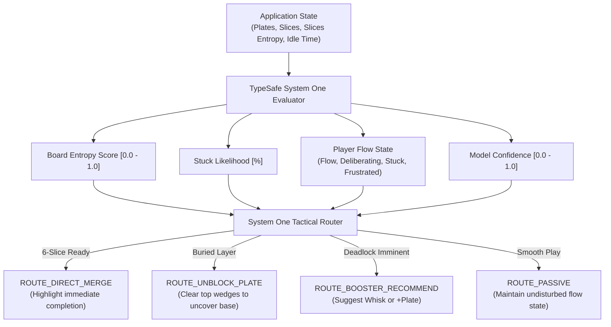

# 🧁 Cake Sort Puzzle 3D — Patisserie Studio
### *Hyper-Casual 3D Match-6 Cake Sorter • Apple Human Interface Design • TypeSafe AI System One • Official YouTube Playables SDK*

<p align="center">
  
  
  
  
  
</p>

---

## 📖 Executive Summary

**Cake Sort Puzzle 3D** is an ultra-tactile, 3D patisserie sorting game engineered for modern web platforms, mobile touchscreens, and **YouTube Playables**. Players lift colorful, multi-layered gourmet cake slices across ceramic counter plates, matching 6 like wedges to bake a whole, glorious artisanal cake.

Built from the ground up with **Apple Design System** aesthetics (SF Pro typography, translucent frosted vibrancy, direct tactile response, and spring-driven physical motion), powered by **TypeSafe AI System One** evaluation and routing models, and integrating the official **YouTube Playables SDK (`ytgame`)** for lifecycle, audio control, cloud saves, engagement scoring, and optional monetization ads.

```
       ┌────────────────────────────────────────────────────────┐
       │                PARISIAN PATISSERIE STUDIO              │
       │                                                        │
       │     [ Plate 1 ]            [ Plate 2 ]   [ Plate 3 ]   │
       │    (🍓🍓🍫🍫)             (🍓🍓🍓🍓)     (🍵🍵🍵🍵)    │
       │         │                       │                      │
       │         └──────> Transfer ─────>┘                      │
       │                     │                                  │
       │             ★ BAKE 6-SLICE CAKE ★                      │
       │             (Ascending Chime Arp)                      │
       └────────────────────────────────────────────────────────┘
```

---

## 🚀 Official YouTube Playables SDK Integration (`ytgame`)

The game connects natively with the YouTube environment using the official **YouTube Playables SDK (v1)**.

### 1. SDK Script Injection (`index.html`)
The SDK is loaded in the `<head>` of `index.html` **before any game code**, creating a reproducible, sandboxed environment:
```html
<script src="https://www.youtube.com/game_api/v1"></script>
```

### 2. Supported SDK Namespaces & Methods

| Namespace | Method / Property | Description | Status |
| :--- | :--- | :--- | :---: |
| **Top-Level** | `ytgame.IN_PLAYABLES_ENV` | Detects if running within YouTube iframe sandbox | ✅ Implemented |
| | `ytgame.SDK_VERSION` | Returns active YouTube Playables SDK version | ✅ Implemented |
| **`ytgame.game`** | `firstFrameReady()` | Notifies YouTube that initial WebGL frame has rendered | ✅ Required |
| | `gameReady()` | Notifies YouTube that game is interactive & ready for players | ✅ Required |
| | `saveData(data)` | Cloud saves game state as serialized UTF-16 string ($\le 3\text{ MiB}$) | ✅ Required |
| | `loadData()` | Cloud loads serialized game state from YouTube | ✅ Required |
| **`ytgame.system`** | `isAudioEnabled()` | Checks initial audio setting from YouTube player | ✅ Required |
| | `onAudioEnabledChange(cb)` | Listens to dynamic audio volume toggles in YouTube UI | ✅ Required |
| | `onPause(cb)` | Saves state before eviction and pauses game/sound | ✅ Required |
| | `onResume(cb)` | Resumes WebAudio context and animations | ✅ Required |
| | `getLanguage()` | Retrieves user's BCP-47 locale (e.g. `en-US`) | ✅ Recommended |
| **`ytgame.engagement`** | `sendScore({ value })` | Sends single-dimension integer score (cakes baked) to YouTube | ✅ Recommended |
| | `openYTContent(content)` | Opens YouTube video or related Playable | ✅ Recommended |
| **`ytgame.ads`** | `requestInterstitialAd()` | Interstitial ads between levels at natural breaks | ✅ Recommended |
| | `requestRewardedAd(id)` | Rewarded ads for bonus coins or free Whisk booster | ✅ Recommended |
| **`ytgame.health`** | `logError()` / `logWarning()` | Logs runtime issues directly to YouTube telemetry | ✅ Recommended |

### 3. Local Testing & Content Security Policy (CSP) Headers
When tested locally or with the [Playables Test Suite](https://developers.google.com/youtube/gaming/playables/test_suite), the game complies with YouTube's strict CSP header:
```http
default-src 'none'; script-src 'report-sample' 'self' 'unsafe-eval' 'unsafe-inline' blob: https://www.youtube.com/game_api/v0 https://www.youtube.com/game_api/v0/ https://www.youtube.com/game_api/v1 https://www.youtube.com/game_api/v1/; object-src 'none'; style-src 'self' 'unsafe-inline' https://fonts.googleapis.com; img-src 'self' blob: data:; media-src 'self' blob:; font-src 'self' data: https://fonts.googleapis.com https://fonts.gstatic.com; connect-src 'self' blob: data:; sandbox allow-pointer-lock allow-same-origin allow-scripts; base-uri 'self'; manifest-src 'self'; worker-src 'self' blob:
```

### 4. Built-in Automated Test Harness
Tap the `▶️` button in the top HUD or press `T` to launch the **YouTube Playables Test Suite**:
- Runs live automated audits across all 9 certification criteria.
- Provides interactive viewport simulation toggles: **Auto Responsive**, **Portrait 9:16**, and **Landscape 16:9**.

---

## 🎨 Apple Human Interface Design (HIG) & Fluid Motion

The visual identity and interaction design adhere strictly to Apple’s **Human Interface Guidelines** and WWDC *Designing Fluid Interfaces* principles:

### 1. Translucent Vibrancy Materials
- **Frosted Acrylic / Mica**: UI chrome recedes into the background using multi-layered Gaussian blurs (`backdrop-filter: blur(28px) saturate(190%)`) framed by delicate $1\text{px}$ hairline borders (`rgba(255, 255, 255, 0.65)`).
- **Physical Shadows**: Replaced harsh black drop-shadows with diffused, dual-tier physical ambient shadows (`0 12px 36px rgba(0, 0, 0, 0.08), 0 1px 3px rgba(0, 0, 0, 0.04)`).

### 2. Kill Latency & Direct Manipulation
- **Instant Press Feedback**: Interactive elements respond on `pointerdown` rather than delayed `click`, depressing instantly with tactile spring dampening:
  ```css
  .pill-btn:active, .booster-btn:active {
    transform: scale(0.96);
    transition: transform 110ms cubic-bezier(0.2, 0.8, 0.2, 1);
  }
  ```
- **Interruptible Motion**: Flying slices and plate selections can be redirected or retargeted mid-flight without locking input.

### 3. Studio 8K Lighting & Photorealistic Patisserie Shaders
- **ACES Filmic Tone Mapping**: Photographic color gamut and dynamic range calibration (`renderer.toneMappingExposure = 1.12`).
- **3-Point Lighting Setup**:
  - Key warm directional light with PCF Soft Shadows.
  - Cool ambient fill light for organic depth.
  - Specular rim light catching the glossy mirror glaze of strawberry, chocolate, and matcha frostings.
- **Micro-Parallax Camera Float**: Responsive camera sway tracking user pointer and tilt with spring interpolation, providing tactile 3D immersion.
- **Squash & Stretch Springs**: When slices land, destination plates experience physical vertical impulse dampening before springing back to equilibrium.

---

## 🧠 TypeSafe AI — System One Evaluation & Routing Architecture

Using the **TypeSafe AI** skill, the game integrates an in-memory evaluation and routing engine modeled on **TypeSafe's System One (Jev)** architecture. Instead of slow LLM text chat, System One models provide instantaneous, typed judgments and probabilities from application state to govern game balance and player guidance.



### In-Game System One Integration
- **Live HUD Strategy Chip**: Displays current tactical status (`[ ✦ TypeSafe AI: Cake Ready ]`).
- **Tactical Inspector Modal**: Players can inspect live Entropy, Stuck Risk, Model Confidence, and one-tap **Apply Recommended Route**.
- **Bakery Style Router**: Evaluates player decor choices (Slate, Carrara Marble, Milano Terrazzo, French Oak) and recommends harmonious palettes.

---

## 🎮 Official YouTube Playables SDK Integration (`ytgame`)

Cake Sort Puzzle 3D complies with the **official YouTube Playables Web SDK (v1)** specification. The SDK is imported as the very first script tag in the root [`index.html`](file:///C:/Users/Admin/Downloads/GitHub/Cake-Sort-Puzzle/index.html) before any game code:

```html
<head>
  <meta charset="UTF-8" />
  <!-- Official YouTube Playables SDK (Must load before any game code) -->
  <script src="https://www.youtube.com/game_api/v1"></script>
  ...
</head>
```

### SDK API Surface & Integration Matrix

The top-level `window.ytgame` namespace is integrated across all game loops:

| Namespace | Method / Property | Contract & Implementation | Certification Status |
| :--- | :--- | :--- | :---: |
| **`ytgame.game`** | `firstFrameReady()` | Called synchronously upon WebGL mount when Three.js renders its first frame. **MUST** precede `gameReady()`. | ✅ REQUIRED / PASSED |
| | `gameReady()` | Dispatched once level state, plates, and DOM HUD are interactable. **MUST NOT** be called while loading screen displays. | ✅ REQUIRED / PASSED |
| | `loadData()` | Asynchronously retrieves cloud save serialized UTF-16 JSON string on game startup. | ✅ REQUIRED / PASSED |
| | `saveData(data)` | Asynchronously persists progress string ($\le 3\text{ MiB}$, validated UTF-16) on move completion and `onPause`. | ✅ REQUIRED / PASSED |
| **`ytgame.system`** | `isAudioEnabled()` | Initializes game audio state to match YouTube player master audio setting. | ✅ REQUIRED / PASSED |
| | `onAudioEnabledChange(cb)` | Dynamically toggles WebAudio gain and mute states when the user toggles player volume. | ✅ REQUIRED / PASSED |
| | `onPause(cb)` | Saves game state immediately before eviction and suspends WebAudio context. | ✅ REQUIRED / PASSED |
| | `onResume(cb)` | Resumes WebAudio context and unfreezes animation timers when player refocuses. | ✅ REQUIRED / PASSED |
| | `getLanguage()` | Retrieves user's current locale as a BCP-47 language tag (e.g., `en-US`, `es-419`, `ja-JP`). | ✅ RECOMMENDED / PASSED |
| **`ytgame.engagement`**| `sendScore({ value })` | Sends single-dimension integer score (total cakes baked, $\le \text{Number.MAX_SAFE_INTEGER}$) to YouTube leaderboard. | ✅ RECOMMENDED / PASSED |
| | `openYTContent(content)` | Opens related patisserie videos or linked Playables using `{ id, contentType: ContentType.VIDEO }`. | ✅ RECOMMENDED / PASSED |
| **`ytgame.ads`** | `requestInterstitialAd()` | Triggered between level completions (natural breakpoints) to monetize smoothly. | ✅ RECOMMENDED / PASSED |
| | `requestRewardedAd(id)` | Awards bonus coins or boosters (e.g. `rewardId: "patisserie-bonus-100-coins"`). | ✅ RECOMMENDED / PASSED |
| **`ytgame.health`** | `logError()` / `logWarning()` | Non-blocking telemetry reporting unexpected exceptions to YouTube portal. | ✅ RECOMMENDED / PASSED |
| **Environment** | `IN_PLAYABLES_ENV` | Detects whether running inside the YouTube iframe sandbox vs. local browser. | ✅ INTEGRATED |
| | `SDK_VERSION` | Logs active SDK version for diagnostics (e.g., `1.0.0`). | ✅ INTEGRATED |

### Official Content Security Policy (CSP) Response Header
For testing locally in Chrome with DevTools Header Overrides, the game validates against the official YouTube Playables CSP:

```http
Content-Security-Policy: default-src 'none'; script-src 'report-sample' 'self' 'unsafe-eval' 'unsafe-inline' blob: https://www.youtube.com/game_api/v0 https://www.youtube.com/game_api/v0/ https://www.youtube.com/game_api/v1 https://www.youtube.com/game_api/v1/; object-src 'none'; style-src 'self' 'unsafe-inline' https://fonts.googleapis.com; img-src 'self' blob: data:; media-src 'self' blob:; font-src 'self' data: https://fonts.googleapis.com https://fonts.gstatic.com; connect-src 'self' blob: data:; sandbox allow-pointer-lock allow-same-origin allow-scripts; base-uri 'self'; manifest-src 'self'; worker-src 'self' blob:
```

### Automated In-Game Test Suite
Tap the `▶️` button on the top HUD to run the automated **YouTube Playables Certification Suite**:
- Runs live automated audits across all 9 SDK criteria.
- Real-time viewport aspect ratio simulation: **Auto Responsive**, **Portrait 9:16 (Mobile)**, and **Landscape 16:9 (Desktop)**.

---

## 🍰 Patisserie Flavor Catalog & Bakery Meta

| Flavor | Sponge Color | Icing & Glaze | Specular Garnish | Sell Coins |
| :--- | :---: | :---: | :--- | :---: |
| **Wild Strawberry** | `#ffd5c2` | `#ff5d8f` | Conical berry with fresh mint leaf | 60 🪙 |
| **Belgian Truffle** | `#422317` | `#2d150c` | Chocolate truffle with gold leaf flakes | 70 🪙 |
| **Kyoto Matcha** | `#cbe3b3` | `#6b9055` | Whipped cream swirl & green mochi | 75 🪙 |
| **Amalfi Lemon** | `#fff1b0` | `#ffd23f` | Toasted meringue cone & candied zest | 80 🪙 |
| **Wild Blueberry** | `#c4c3e8` | `#4d4ba8` | Dual forest blueberries & sugar leaf | 85 🪙 |
| **Royal Red Velvet** | `#8c1d2e` | `#fffaf0` | Cream cheese dollop with ruby red crumb | 90 🪙 |
| **Salted Caramel** | `#e5be90` | `#b86828` | Caramel fudge cube & espresso bean | 95 🪙 |
| **Sicilian Pistachio** | `#d7e5b8` | `#87a94b` | Rosette cream & crushed pistachio nut | 100 🪙 |

### Bakery Studio Customization
- **Countertops**: French Warm Oak, Carrara Italian Marble, Milano Terrazzo, Midnight Slate.
- **Ceramic Plates**: Pure Porcelain White, Royal Gold Gilding, Celadon Mint, Rose Quartz.
- **3D Tabletop Props**: Macaron Tower, Vintage Copper Teapot, Fresh Pastel Tulips, Golden Chef Trophy, Ambient Fairy Lights.

---

## 🛠️ Boosters & Assist Tools

1. **↩️ Undo**: Rewind last slice movement with zero coin penalty.
2. **🍽️ +Plate**: Adds an extra ceramic plate to the counter to relieve congestion.
3. **🪄 Whisk (Shuffle)**: Redistributes scattered slices into consolidated flavor groups.
4. **✨ Auto-Cake**: Instantly gathers 6 matching slices from across the counter and bakes a complete cake!
5. **💡 Smart Hint**: Leverages TypeSafe System One to illuminate the highest-scoring move with an Action Blue halo ring.

---

## 💻 Tech Stack & Architecture

- **Runtime**: HTML5, TypeScript 5.7, Vite 6
- **YouTube Playables**: Official `ytgame` SDK (v1)
- **3D Graphics**: Three.js (r170) with `PCFSoftShadowMap` and `ACESFilmicToneMapping`
- **Audio**: Web Audio API (100% synthesized procedural oscillators, zero MP3 assets)
- **AI Framework**: TypeSafe System One (Jev-compatible typed evaluation & routing)
- **Styles**: Apple Design System (CSS variables, backdrop filter vibrancy, safe-area insets)
- **Target Platform**: YouTube Playables, iOS Safari PWA, Android Chrome, Desktop Web

---

## 📦 Local Development & Build

### Prerequisites
- Node.js (v18+)
- npm (v9+)

### Installation
```bash
# Clone the repository
git clone https://github.com/rrkpublisher56955/Cake-Sort-Puzzle.git
cd Cake-Sort-Puzzle

# Install dependencies
npm install

# Start local development server
npm run dev

# Compile production bundle
npm run build

# Preview production build
npm run preview
```

The compiled output in `/dist` is a single-directory, zero-CDN web application ready for direct deployment to **YouTube Playables**, **GitHub Pages**, or any static web host.

### ⚡ Instant Standalone Demo (Zero Dependencies)
For instant evaluation without Node.js or build steps:
- Double-click [`standalone.html`](file:///C:/Users/Admin/Downloads/GitHub/Cake-Sort-Puzzle/standalone.html) in any modern browser (Safari, Chrome, Edge).
- 100% self-contained single-file HTML5 experience featuring Apple frosted glass aesthetics, Web Audio procedural synthesis, the depth-first solvable level solver, and official `ytgame` SDK integration hooks.

---

<p align="center">
  <b>Designed with precision in Cupertino style • Powered by TypeSafe AI • Built for YouTube Playables</b>
</p>
